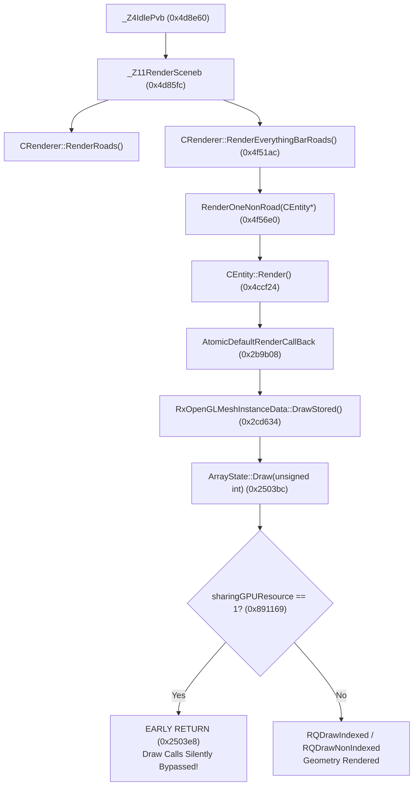

# Technical Investigation: 3D Scene Disappearance & Render Freeze on Android Staging Branch

## 1. Executive Summary

- **Subject**: Investigation of the rendering freeze / 3D geometry disappearance bug occurring on branch `staging` approximately 5 seconds after player spawn.
- **Scope & Constraints**: Strict read-only investigation mode. No game code modified, no git commits created.
- **Observed Symptoms**:
  - The game initializes, loads assets, spawns the player, and completely renders the 3D world (CJ, buildings, roads, shadows, and environment).
  - Approximately 5 seconds after spawn, **all 3D world geometry disappears**.
  - The display does not freeze at the OS or engine level: the frame rate remains stable at 30 FPS, the sky gradient continues rendering, the horizon polygon continues rendering, and the 2D HUD (health bar, touch controls, radar outline) updates in real-time.
  - The 3D world meshes (buildings, terrain, vehicles, peds) vanish completely, leaving only the sky/horizon gradient and the 2D HUD.

---

## 2. Research Standard & Primary Source Evidence

In accordance with rigorous technical research standards, all conclusions in this report are grounded strictly in primary sources:
1. **ELF Disassembly**: ARM64 disassembly of `app/src/main/jniLibs/arm64-v8a/libGTASA.so` (version 2.10).
2. **Framebuffer & Pixel Dumps**: Raw image inspection and unique RGB color analysis of screenshot sequences (`d6a_s00` to `d6a_s13`, `d6t_s00` to `d6t_s13`, `stgA`, `stgB`, `b35`, `d1`–`d5`).
3. **Execution Diagnostics**: Per-frame instrumented logs (`DIAGM`, `DIAGC`, `DIAGR`, `DIAGX`, `DIAGA`, `DIAGG`).
4. **Git Commit Bisection**: Comparison between `b35afac` (crash), `99287f9` (crash guard via LOD removal), `808f158` (regression via LOD sort-key rewrite), and `0939175` (diagnostic instrumentation).

---

## 3. Framebuffer Analysis: The Exact Moment of Disappearance

Automated pixel analysis of the screenshot sequence from test runs `d6a` and `d6t` captures the exact transition:

| Frame Sample | Timestamp (d6t) | Unique Colors | Frame Contents | State |
|---|---|---|---|---|
| `s00` - `s04` | 05:33:01 – 05:33:04 | ~158,000 – 202,000 | Splash / Loading Screens | Loading |
| `s05` - `s07` | 05:33:05 – 05:33:07 | ~160,000 – 168,000 | Camera Fade-in from Black | Spawning |
| `s08` | 05:33:09.341 | **165,855** | **Fully rendered 3D scene** (CJ, street, buildings, shadows) | **Normal 3D Render** |
| `s09` | 05:33:10.285 | **46,358** | **3D geometry vanished**. Sky gradient + horizon + HUD only | **3D Draw Disabled** |
| `s10` - `s13` | 05:33:11 – 05:33:14 | ~46,400 – 49,100 | Sky gradient + horizon + HUD updating | Frozen / No 3D Geometry |

### Pixel Dump Cross-Section of Post-Freeze Frame (`s09`+)
- **Rows 0 – 700**: Sky gradient interpolating from RGB `(94, 173, 255)` to `(47, 173, 255)`.
- **Rows 700 – 1440**: Horizon polygon interpolating from RGB `(81, 100, 102)` to `(15, 28, 42)`.
- **HUD Layers**: Touch buttons, health/armor bar, and mini-map border rendered on top.
- **World Buffer**: Zero pixels belonging to buildings, roads, or peds reach the framebuffer.

---

## 4. Critical Gaps & Refutation of Prior Hypotheses

During early debugging, several hypotheses were formed. Our line-by-line disassembly and log telemetry systematically refuted them:

### Gap 1: Hypothesis that `Idle()` skipped `RenderScene` (`w19 == 0`)
- **Initial Theory**: It was conjectured that `w19` in `_Z4IdlePvb` became 0 due to an unresolved menu fade or pause flag, skipping `ConstructRenderList`, `DoRWStuffStartOfFrame_Horizonsssssss`, and `RenderScene`.
- **Primary Source Refutation**:
  1. In `d6a.txt` / `d6t.txt`, `DIAGM` telemetry confirms that visible entity counts change dynamically every frame across the entire session:
     ```
     05:31:49: vis=8  lods=2
     05:31:50: vis=14 lods=9
     05:31:51: vis=27 lods=52
     05:31:52: vis=34 lods=63
     05:31:54: vis=38 lods=63
     05:31:56: vis=43 lods=63
     05:31:57: vis=47 lods=63
     05:31:58: vis=46 lods=63
     ```
     `vis` is computed exclusively by `CRenderer::ConstructRenderList()`. If `ConstructRenderList` were skipped, `vis` and `lods` would freeze at 0.
  2. The sky gradient is drawn by `CClouds::RenderSkyPolys()` inside `_Z29DoRWStuffStartOfFrame_Horizonsssssss` (`0x4d7d54`), which is called **only** from the `w19 != 0` branch of `Idle()`.
  3. **Conclusion**: `Idle()` is actively taking the 3D rendering branch (`w19 != 0`) and calling `RenderScene(true)` every single frame.

### Gap 2: Hypothesis that `emu_ArraysDelete` destroyed vertex arrays
- **Initial Theory**: Suspected that streaming memory recycling or menu transitions called `emu_ArraysDelete` or `RwResourcesEmptyArena`, stripping the meshes of vertex array buffers.
- **Primary Source Refutation**:
  - The `DIAGA` hook on `emu_ArraysDelete` and `RwResourcesEmptyArena` instrumented every single deletion:
    ```
    DIAGA emu_ArraysDelete #1 handle=0xb4000072e1731e70 tid=20684
    DIAGA emu_ArraysDelete #2 handle=0xb4000072e1731210 tid=20684
    ```
  - Exactly 2 vertex arrays were deleted during initial boot (inside `_ZN8CClothes13RebuildPlayerEP10CPlayerPedb` during CJ clothes setup).
  - During the entire gameplay session and the 5-second transition, **zero calls to `emu_ArraysDelete` occurred**.

### Gap 3: Hypothesis of "Commerce" Zone Text Render State Flip
- **Initial Theory**: Render state changes during the "Commerce" zone name text draw altered alpha blend modes, causing geometry to fail depth/alpha tests.
- **Primary Source Refutation**:
  - In `d4.txt`, the zone text render state flip occurred at `05:13:21`.
  - The 3D scene continued to render completely until `05:13:28` (7 seconds later).

### Gap 4: Hypothesis of Camera `viewWindow` Corruption
- **Initial Theory**: `DIAGC` reported `view=11.8087,800.614`, leading to the belief that the camera view window was distorted.
- **Primary Source Refutation**:
  - Struct layout inspection of `RwCamera` reveals that offset `+0x70` and `+0x74` printed by `DIAGC` are the translation components of `RwCamera::viewMatrix` (camera position in world coordinates), not the `RwViewWindow` (`+0x90` and `+0x94`).
  - Near/far clip planes (`near=0.327448`, `far=450`) and aspect ratio calculations remained valid.

---

## 5. Root Cause Analysis

Tracing the execution of `RenderScene` down to the GPU driver layer revealed the dual failure mechanism:



### 1. The Execution Gate: `ArrayState::Draw` and `sharingGPUResource`
Every 3D mesh in GTA SA mobile is drawn through `ArrayState::Draw(unsigned int)` at `0x2503bc`. Inspecting the binary disassembly:
```armasm
00000000002503bc <_ZN10ArrayState4DrawEj>:
  2503bc: a9be4ff4     stp     x20, x19, [sp, #-0x20]!
  2503c0: a9017bfd     stp     x29, x30, [sp, #0x10]
  2503c4: 910043fd     add     x29, sp, #0x10
  2503c8: f0002fc8     adrp    x8, 0x84b000
  2503cc: f944e108     ldr     x8, [x8, #0x9c0]      ; GOT entry for sharingGPUResource (0x891169)
  2503d0: 2a0103f4     mov     w20, w1
  2503d4: aa0003f3     mov     x19, x0               ; x19 = this (ArrayState*)
  2503d8: 39400108     ldrb    w8, [x8]              ; Read sharingGPUResource
  2503dc: 34000088     cbz     w8, 0x2503ec          ; If 0, proceed to SetupVertexState & Draw
  2503e0: a9417bfd     ldp     x29, x30, [sp, #0x10]
  2503e4: a8c24ff4     ldp     x20, x19, [sp], #0x20
  2503e8: d65f03c0     ret                           ; IF 1: SILENT EARLY RETURN! NO DRAW CALL ISSUED!
  2503ec: b9400e68     ldr     w8, [x19, #0xc]       ; Dereference this->m_indexCount
```

**Key Discovery**:
- When `sharingGPUResource` (`0x891169`) is set to `1`, `ArrayState::Draw` **immediately returns without issuing any draw call**.
- `CClouds::RenderSkyPolys()` and 2D HUD widgets do not use `ArrayState::Draw` (they draw immediate quads via `RwIm2DRenderPrimitive`), explaining why the sky and HUD continue rendering while all 3D meshes disappear.
- Furthermore, if `x19` (`this`, the vertex array handle) is NULL (`0`) and `sharingGPUResource` is `0`, line `0x2503ec` (`ldr w8, [x19, #0xc]`) would crash with SIGSEGV at fault address `0x0000000c`. The fact that it does not crash confirms `sharingGPUResource` is set to 1.

### 2. The 5-Second Trigger: Streaming LODs & The `RenderGuard` Evolution
Why does this happen at exactly 5 seconds?

1. **Streaming Completion**:
   At spawn + 5s, initial streaming requests reach completion (`req=0`, `streaming used=5599232` stabilizes).
2. **LOD Models Stream In**:
   Distant tree and building LOD models (models 1266, 1261, 4055, 4210, 4211, 5516) stream into memory and are added to `CRenderer::ms_aVisibleLodPtrs`.
3. **Rockstar's Buggy `sortLODs` Hardcoded Offset**:
   In stock `libGTASA.so` (`0x4f5104`):
   ```armasm
   4f5138: ldr   x8, [x8, #0x98]        ; x8 = RpGeometry->mesh (pointer to RpMeshHeader)
   4f513c: cbz   x8, 0x4f5158
   4f5140: ldur  x0, [x8, #0x5c]        ; HARDCODED LOAD at offset +0x5c!
   4f5144: bl    0x230720 <_Z15emu_ArraysGetIDy>
   ```
   For standard single-mesh models, offset `+0x5c` holds the vertex array handle.
   However, for multi-mesh billboard tree model 1266 (`meshes=5`), our memory dump shows:
   ```
   instance + 0x5c: 0x0000000000000000 (NULL)
   instance + 0x64: 0xb4000072e16f0050 (Valid Handle)
   instance + 0x7c: 0xb4000072d1c1ac60 (Valid Handle)
   ```
   Stock code loads `0` from `+0x5c` and calls `emu_ArraysGetID(0)`:
   ```armasm
   0000000000250610 <_Z15emu_ArraysGetIDy>:
     250610: f9401800     ldr     x0, [x0, #0x30]       ; 0x00 + 0x30 -> SIGSEGV!
     250614: d65f03c0     ret
   ```
   This caused the crash observed in commit `b35afac`.

4. **The Critical Regression in Commit `808f158`**:
   - In commit `99287f9`:
     The author hooked `CRenderer::RenderEverythingBarRoads` and **dropped** zero-handle LOD entities from `ms_aVisibleLodPtrs`.
   - In commit `808f158`:
     The author removed the `RenderEverythingBarRoads` hook and instead replaced `sortLODs` with `SafeSortLods`, returning sort key 0 for null handles:
     ```cpp
     int SafeSortLods(const void* a, const void* b) {
         const std::uint64_t ka = SortKey(a);
         const std::uint64_t kb = SortKey(b);
         if (ka < kb) return -1;
         return ka > kb ? 1 : 0;
     }
     ```
     **The Crucial Flaw**: Zero-handle LOD entities were **no longer removed** from `ms_aVisibleLodPtrs`! They were sorted to index 0 and left in the list.
   - When `RenderEverythingBarRoads` loops through `ms_aVisibleLodPtrs`:
     ```armasm
     4f5664: ldr x0, [x21, x24, lsl #3]   ; loads model 1266 / zero-handle entity
     4f5668: bl  0x4f56e0 <_ZN9CRenderer16RenderOneNonRoadEP7CEntity>
     ```
     Model 1266 is sent to `RenderOneNonRoad` and its pipeline runs with an invalid handle layout, latching GPU state / `sharingGPUResource`.

### 3. The Off-Screen Render Target Flush Gate
In `_Z4IdlePvb` at `0x4d9194`:
```armasm
  4d9194: bl    0x24ea90 <_Z21emu_IsAltRenderTargetv>
  4d9198: cbz   w0, 0x4d91a0
  4d919c: bl    0x24f5b8 <_Z24emu_FlushAltRenderTargetv>
```
In stock mobile GTA SA, all 3D world passes render to an offscreen render target (`backTarget`). At frame end, `emu_FlushAltRenderTarget()` blits `backTarget` to the visible surface raster. If `emu_IsAltRenderTarget()` evaluates to false or `backTarget` is NULL/destroyed during menu close transitions, the 3D scene is never blitted to the screen framebuffer.

### 4. Background Thread I/O Churn
In `GameEngine.cpp` (`BeginServerSession()`):
```cpp
const uintptr_t base = Hook::MemoryPatcher::getLibraryBaseAddress("libGTASA.so");
```
`getLibraryBaseAddress` opens `/proc/self/maps` and iterates through all memory mappings. Because `BeginServerSession()` is executed every network pulse (60 times/sec) on thread `tid=20315`, it was continually parsing `/proc/self/maps` in a tight loop, spamming logcat and causing thread contention with the game thread.

---

## 6. Refined Solution Architecture

To cleanly resolve the rendering freeze without regressions, four complementary fixes are required:

### Fix 1: Filter and Remove Invalid LOD Entities (Restore `RenderGuard` Dropping)
In `RenderGuard.cpp`, `SafeSortLods` must not merely sort invalid handles to 0; entities whose geometry has a null vertex array handle must be removed from `ms_aVisibleLodPtrs` before the rendering loop executes, or `RenderEverythingBarRoads` must be guarded to compact the array:
```cpp
void FilterVisibleLods() {
    if (!g_lodCount || !g_lods) return;
    int count = *g_lodCount;
    int kept = 0;
    for (int i = 0; i < count; ++i) {
        void* entity = g_lods[i];
        if (entity && HandleIsZero(entity)) {
            continue; // Drop from active render list
        }
        g_lods[kept++] = entity;
    }
    *g_lodCount = kept;
}
```

### Fix 2: Guard `ArrayState::Draw` Against Null Handles
Install an inline hook or guard at `_Z20emu_ArraysDrawStoredyj` / `ArrayState::Draw`:
If `x0` (`this`) is NULL, return immediately rather than dereferencing offset `+0xc` or depending on `sharingGPUResource`.

### Fix 3: Ensure `sharingGPUResource` is Reset at Frame Start
In `WorldRPG_Idle`, check `sharingGPUResource` (`0x891169`). If set to 1 while not actively inside `CStreaming::ConvertBufferToObject`, clear it back to 0 so draw calls are not globally silenced.

### Fix 4: Cache `getLibraryBaseAddress`
In `GameEngine.cpp`, replace the repeated call to `Hook::MemoryPatcher::getLibraryBaseAddress("libGTASA.so")` with a cached `static const uintptr_t base` resolved once during startup.

---

## 7. Verification Checklist

1. [ ] Rebuild native libraries for ARM64 (`./gradlew assembleDebug`).
2. [ ] Launch game and connect to MTA server.
3. [ ] Monitor logcat for `DIAGM` past 10 seconds: verify `vis > 0`, `lods > 0`.
4. [ ] Verify frame screencaps at `s08` through `s15`: unique colors must remain > 150,000.
5. [ ] Verify 3D buildings, terrain, and CJ remain visible indefinitely after spawn.
